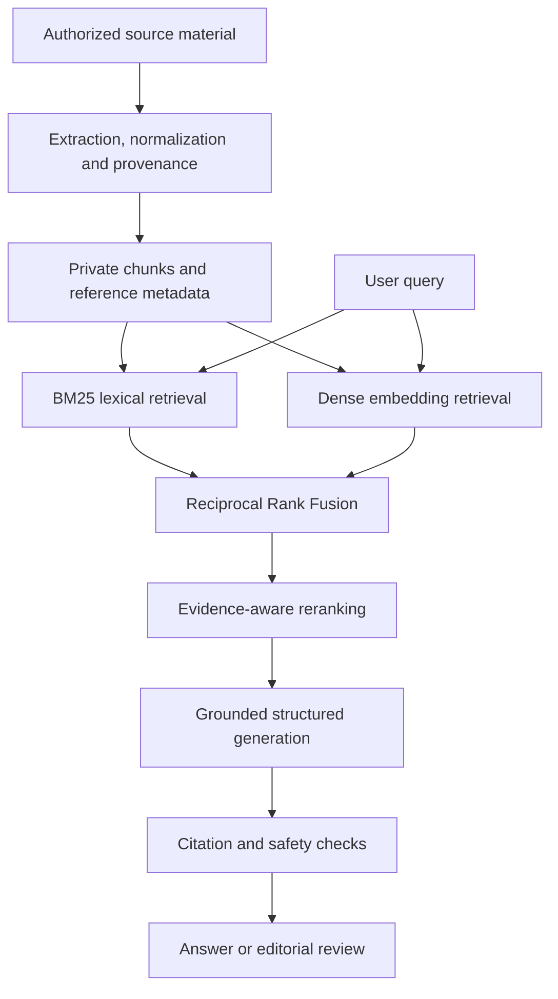

# LongevityRAG — Technical Overview

**Reviewed: 24 October 2026 · Documentation only**

LongevityRAG is an evidence-oriented retrieval and content pipeline. This overview describes implementation boundaries without distributing application source code, research documents, prompts, embeddings, or the private knowledge base. It is an architecture review, not a live-service audit or a clinical validation report.

## Architecture

## Technologies

| Layer | Technologies and role |
| --- | --- |
| Pipeline and orchestration | Node.js, JavaScript, structured JSON and CSV artifacts |
| Embeddings and generation | Gemini API adapters, with separately configurable model calls |
| Vector export | Python, NumPy, PyArrow/Parquet and FAISS |
| Hosted retrieval boundary | PHP and MySQL FULLTEXT, authenticated separately |
| Editorial delivery | WordPress REST and validation/archival tooling |

## How hybrid RAG works

1. Ingestion normalizes permitted material into traceable documents, overlapping chunks and reference metadata.
2. **BM25** finds lexical matches; **dense retrieval** scores normalized semantic vectors against a query embedding.
3. **Reciprocal Rank Fusion** combines the two ranked lists without assuming their raw scores share a scale.
4. Local reranking incorporates evidence metadata and reference availability. An optional model reranker is a separate step; it is not required for the default local reranking path.
5. Selected evidence is passed to a structured answer generator. Citation identifiers are constrained to the retrieved reference set and repeated source URLs are consolidated.

The checked Node.js dense-query path uses exact vector scoring. FAISS is supported by export tooling; this overview does not claim that every query uses FAISS. A local lexical-only fallback is available without model calls. Development vector fallbacks are distinguished from real provider embeddings.

The separate hosted PHP/MySQL search path uses FULLTEXT retrieval. Its existence should not be interpreted as proof that a deployed endpoint runs the full dense-plus-BM25 pipeline.

## Validation and its limits

- Corpus/index checks cover identifiers, duplicate and missing mappings, vector dimensional consistency and orphaned entries.
- Retrieval tests cover lexical ranking, rank fusion and rejection of invented candidate identifiers.
- Answer checks constrain source links, citation identifiers, structured sections, confidence handling and high-risk safety notices.
- Editorial checks and content-access separation are distinct from retrieval quality; private material is not made public by the publishing workflow.

These are software consistency and policy checks. Evidence labels and citation attachment include heuristics: a valid citation identifier does not establish that every generated claim is supported. Expert review and separately measured retrieval/answer evaluations remain necessary. No accuracy, medical-efficacy or production-availability benchmark is claimed here.

## Publication boundary

This repository contains this overview and its diagram only. No corpus excerpts, vectors, private endpoints, deployment details, credentials, personal records, or application code are included.

Related: [longevity120.ai](https://github.com/Igorrr77/longevity120-ai-technical-overview) · [PainMinus.ai](https://github.com/Igorrr77/painminus-ai-technical-overview)
